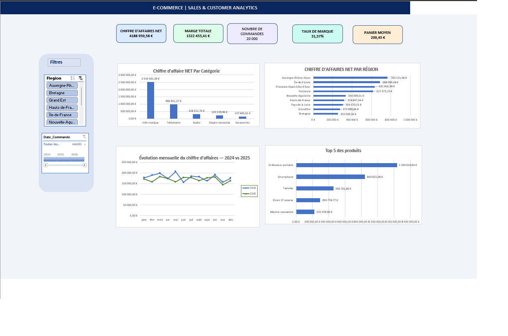

📊 E-Commerce Analytics | Dashboard Excel Interactif

Présentation du projet

Ce projet consiste à analyser 20 000 transactions e-commerce fictives réalisées entre 2024 et 2025, à l'aide de Microsoft Excel 2021.

L'objectif est de transformer les données commerciales en indicateurs de performance et en visualisations interactives pour faciliter la prise de décision.

Le projet couvre la préparation des données, le calcul des KPI, l'analyse des ventes et la conception d'un tableau de bord dynamique.

Aperçu du Dashboard:

Le Dashboard permet de filtrer les résultats par région et par période afin d'explorer les performances commerciales.

Indicateurs clés (KPI)

Indicateur  Résultat global  :

Chiffre d'affaires net

4 188 959,58 €

Marge totale

1 322 453,41 €

Nombre de commandes

20 000

Panier moyen

209,45 €

Taux de marque

31,57 %

Les résultats correspondent à l'ensemble des données, sans filtre actif.

Analyses réalisées

Chiffre d'affaires par catégorie : identification des catégories contribuant le plus aux ventes.

Performance régionale : comparaison du chiffre d'affaires entre les régions françaises.

Évolution mensuelle : comparaison des ventes de 2024 et de 2025.

Top 5 des produits : identification des produits générant le chiffre d'affaires le plus élevé.

Analyse interactive : exploration des résultats à l'aide d'un segment Région et d'une chronologie Date_Commande.

Technologies et outils:

Microsoft Excel 2021 : analyse et visualisation des données.

Power Query : préparation, nettoyage et transformation des données.

Tableaux croisés dynamiques (TCD) : agrégation et synthèse des indicateurs.

Graphiques Excel : visualisation des performances.

Segments et chronologie : filtrage interactif.

Formules Excel : calcul et affichage dynamique des KPI.

Principaux résultats

L'analyse fait ressortir plusieurs enseignements :

Un chiffre d'affaires net global d'environ 4,19 millions d'euros.

Une marge totale d'environ 1,32 million d'euros.

Un taux de marque global de 31,57 %.

La catégorie Informatique représente la contribution la plus importante au chiffre d'affaires.

Le produit Ordinateur portable occupe la première place du classement des produits par chiffre d'affaires.

Les performances commerciales varient selon les régions et les périodes étudiées.

Structure du projet

02-Excel-Commerce-Electronique-Analyse/
│
├── Projet_Final_Ecommerce_Analytics.xlsx
├── Tableau de bord_Commerce électronique.png
└── README.md

Comment utiliser le Dashboard:

Télécharger le fichier Projet_Final_Ecommerce_Analytics.xlsx.

L'ouvrir avec Microsoft Excel.

Accéder à la feuille Dashboard_Modele.

Utiliser le segment Région et la chronologie Date_Commande pour filtrer les résultats.

Observer l'actualisation des KPI et des graphiques.

Compétences développées

Ce projet m'a permis de renforcer mes compétences en :

Préparation et transformation des données.

Analyse exploratoire des ventes.

Construction d'indicateurs de performance.

Conception de tableaux de bord interactifs.

Data visualisation et communication des résultats.

Structuration et documentation d'un projet analytique.

Auteur

Sangaré Ali

Master 2 Business & Data Analyst — Université Grenoble Alpes

Projet réalisé dans le cadre de mon parcours de perfectionnement en Data Analytics.

Données fictives utilisées à des fins pédagogiques et de démonstration.
